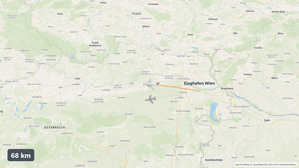
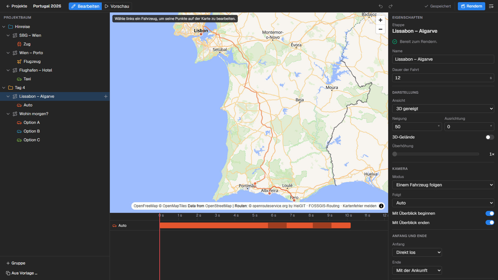
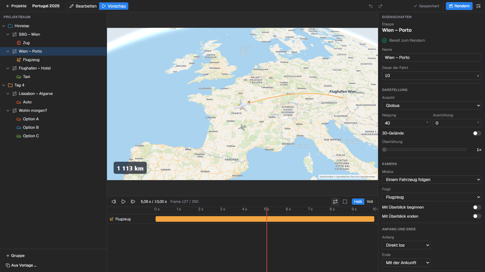
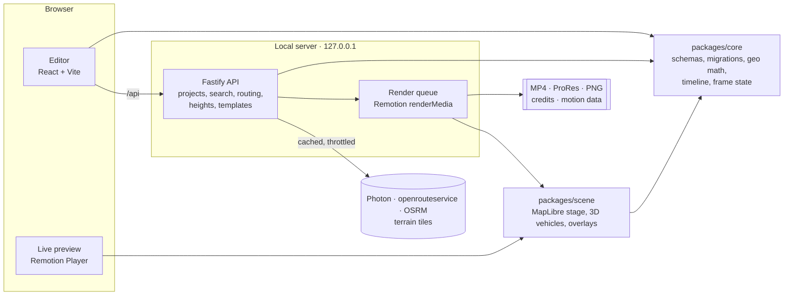

# Travel Route Animator

[](https://github.com/NihadCommits/travel-route-animator/actions/workflows/ci.yml)
[](LICENSE)


Animated travel route maps for vlogs, built in a local editor and rendered straight to video for Premiere Pro.



**New here?** The [quick start](QUICKSTART.md) walks you from download to your first video, no programming needed ([auf Deutsch](QUICKSTART.de.md)).

[English](#english) · [Deutsch](#deutsch)

---

## English

Travel Route Animator turns a trip into map animations for travel videos: a train rolls from Salzburg to Vienna, a plane arcs over the globe to Porto, several cars head to different destinations at once. Routes are built in an editor, checked in a live preview and exported as video files ready to cut. It replaces subscription apps for route animations, runs entirely on your machine and uses free map, routing and terrain data.

**Version 1.0.** Everything below works today; see the [changelog](CHANGELOG.md) for how it got here.

### Features

**Build the trip**

- A project tree of groups, stages, vehicles and waypoints, with drag and drop, autosave, undo and redo, and checks right at the field.
- Waypoints from a place search, airport codes (`VIE`, `OPO`) or a click on the map; points drag on the map, and a click on the line bends the route.
- Tracks imported from a watch or app (GPX, FIT or TCX, also the ZIP of Garmin Connect's or Strava's "Export Original") or from the subtitle file a DJI drone writes, with stops suggested from breaks and named waypoints. From 1.2.0: FIT, TCX and the export ZIPs, and with timestamps the recorded pace: slower uphill, faster downhill, long breaks left out on request.
- Templates for stages and groups, usable in every project, and a return trip in one click.

**Routes and vehicles**

- Real road, cycling and walking routes from openrouteservice, with OSRM as a way out; flights on great circles, also across the date line; trains and ferries on a smooth curve.
- Several vehicles per stage with their own start, duration and easing, stops with pauses, and route options shown as dashed lines that set off together.
- 3D planes in ten aircraft types (A320 to A380) and 3D cars in six body types, all built from their real dimensions without model files; or your own PNG or animated GIF as the vehicle.

**Camera and map**

- 2D, a tilted 3D view or the globe; a camera that follows one vehicle, keeps all in the picture or shows the overview, with a smooth lag and close-ups for take-off and landing.
- Five built-in map themes and a theme editor, place names in the local language, German or English, labels switched off kind by kind, and satellite imagery.
- 3D terrain with hillshading, a colour relief and labelled contour lines; cars and planes stand on the ground as it is drawn.

**Telling the story**

- A whole group of stages as one video on a single map, with cuts, camera flights or fades in between.
- A 3D arrival that circles the destination, a dive straight down onto it for a hard cut to your footage, or a dive-out at the start.
- Photos with GPS data and place names that pop up as pins along the way.
- Overlays for kilometres, travel time, metres climbed and a height profile with a moving point. From 1.2.0 they are blocks you drag to their place in the preview: also current height, progress, the last stop, free text and the flag of the country you are in, the real speed, heart rate and cadence of a recording, and a clock or date in the stage's own time zone. Ten styles with bundled open fonts, metric or imperial, inherited from project to group to stage, and own styles for every project.

**Preview and export**

- A live preview drawn by the very composition the export renders, a timeline with draggable vehicle bars, and safe-area guides for vertical video.
- H.264 MP4, ProRes 422 HQ, ProRes 4444 with alpha or a PNG sequence, any aspect ratio up to 4K, with presets such as "YouTube 4K 25p" or "Reel 1080×1920 30p".
- A transparent overlay without the map, to lay routes and vehicles over your own footage.
- A render queue that survives restarts and renders whole projects in several formats.
- Next to every video: its credits for the description, and on request the position of every vehicle in every frame for After Effects, Premiere Pro, CSV and JSON.
- A Windows app with an installer that renders offline.

### Screenshots





### How it works



- **One composition for preview and export.** The editor's preview and the server's renderer run the same Remotion composition, so the video shows exactly what the preview showed.
- **Every frame is a pure function.** `computeFrameState(timeline, frame)` in `packages/core` decides where each vehicle is, what the camera does and what is shown, from the compiled timeline and the frame number alone. No state between frames, no timers, no map animations: Remotion may render frames in any order and in parallel, and a frame looks the same every time. This is why the core is fully unit tested.
- **The data model is the contract.** Project files are validated with Zod schemas, versioned and migrated on load. The editor checks input against the same schemas as the server.
- **Keys stay on the server.** The browser only talks to the local server, which holds the API keys, caches every answer and throttles requests to free services as their fair-use rules ask. The server listens on localhost only and answers only pages from this computer, so other web sites cannot use it, not even by pointing their domain at 127.0.0.1.

Decisions and their reasons are recorded as architecture decision records while building, one per module.

### Requirements

On Windows, the easiest way is the app from the [latest release](https://github.com/NihadCommits/travel-route-animator/releases/latest): an installer, no tools needed (see the [quick start](QUICKSTART.md)). To run it from the source code:

- Node.js 24 LTS
- pnpm 12
- Git
- A GPU is recommended for rendering

### Getting started

```bash
pnpm install
pnpm data:airports
pnpm dev
```

`pnpm data:airports` downloads the airport list once (see Data sources). `pnpm dev` starts the editor on <http://127.0.0.1:5173> and the server on <http://127.0.0.1:5174>. Both only listen on localhost. To look around first, copy `examples/portugal-2026/` into `data/projects/`: the example trip has its routes inside and renders without any key.

Settings live in a `.env` file (copy `.env.example`): `SERVICE_CONTACT` is sent to free services such as Photon and OSRM, as their fair-use policies ask (a profile URL works). Road, cycling and walking routes need a free [openrouteservice](https://openrouteservice.org/dev/) key in `ORS_API_KEY`; it stays on the local server and is never logged. Without it, the editor explains what is missing and offers OSRM instead. Satellite imagery needs a [MapTiler](https://www.maptiler.com/) key in `MAPTILER_API_KEY`.

| Command              | What it does                                                                                           |
| -------------------- | ------------------------------------------------------------------------------------------------------ |
| `pnpm dev`           | Editor and server in watch mode                                                                        |
| `pnpm test`          | All unit tests (Vitest)                                                                                |
| `pnpm test:coverage` | Unit tests with a coverage report (as in CI)                                                           |
| `pnpm test:e2e`      | The end-to-end test in Edge or Chrome (Playwright, see Testing)                                        |
| `pnpm lint`          | ESLint, warnings count as errors                                                                       |
| `pnpm typecheck`     | TypeScript in every package                                                                            |
| `pnpm format`        | Format everything with Prettier                                                                        |
| `pnpm data:airports` | Download and filter the airport list into `data/airports/`                                             |
| `pnpm render:etappe` | Render one stage of a project to MP4, ProRes or PNGs (see below)                                       |
| `pnpm studio`        | Open the stage and sequence compositions, the aircraft types and the car body types in Remotion Studio |
| `pnpm screenshots`   | Take the screenshots in this README again, from the example trip                                       |
| `pnpm app`           | Build the Windows app and start it (see below)                                                         |
| `pnpm app:installer` | Build the Windows installer (see below)                                                                |

### Rendering

To render a stage, select it (or one of its vehicles) in the editor and click **Rendern**. Format, resolution and frame rate start from the project's defaults and apply to this render only. The video lands in `output/<project>/`, named after the stage, its format and the time, e.g. `lissabon-algarve_16x9_1080p_20261029-1530.mp4`. While a video is rendered it is called `….partial.mp4`; a cancelled or failed render leaves nothing behind. The server bundles the scene once when it starts and renders with the GPU; `RENDER_GL` in `.env` picks another OpenGL backend if renders fail.

The same render works from the command line, given a project file and the name of a stage:

```bash
pnpm render:etappe --file examples/portugal-2026/project.json --etappe "Wohin morgen?"
```

`--aspect 9:16`, `--resolution 2160p` and `--fps 30` override the project's output settings, `--codec prores-4444` (or `prores-422hq`, `png-sequence`) picks the format, `--overlay` leaves the map out, `--motion` also writes the vehicles' motion, and `--gl vulkan` tries another OpenGL backend (default `angle`, the GPU). Road routes the project does not hold yet come from the local server; if it is not running, the script starts it for the routes and stops it again. The first render downloads Chrome Headless Shell (about 100 MB) once. Remotion Studio listens on your whole network, not only on localhost (Remotion has no option for that), so only start it on networks you trust.

### Windows app

`pnpm app` builds the editor, the scene bundle and an Electron shell into `apps/desktop/dist` and starts the app: one window, no terminal and no browser. The local server runs inside the app on <http://127.0.0.1:5175>, so it can run next to `pnpm dev`. The app keeps its projects in `%APPDATA%\Routen-Animator` and its videos in `Videos\Routen-Animator`. On the first start it brings the example trip along and offers to copy the projects from the repo's `data` folder; the originals stay where they are. Instead of `.env`, the app has its own settings (Datei → Einstellungen): the openrouteservice and MapTiler keys, which Windows keeps encrypted for your user account, the contact for free services, the video folder and the OpenGL backend for rendering. The first `pnpm app` downloads Electron (about 100 MB) once.

`pnpm app:installer` builds the installer: `apps/desktop/release/Routen-Animator Setup <version>.exe`. It installs the app for your Windows user only (no admin rights needed), with a start menu entry and a desktop shortcut. The installed app brings its own Chrome Headless Shell and ffmpeg, so it renders offline right away. The installer is not code-signed, so Windows SmartScreen says "Windows protected your PC" on the first start: click "More info", then "Run anyway". With Smart App Control turned on, Windows blocks an unsigned build outright and offers no "Run anyway"; start the app with `pnpm app` instead. Uninstalling the app keeps your projects and videos. `apps/desktop/release/win-unpacked/Routen-Animator.exe` is the same app without installing it.

### Keyboard shortcuts in the editor

| Keys                                  | Action                                                |
| ------------------------------------- | ----------------------------------------------------- |
| `Ctrl+Z` / `Ctrl+Shift+Z` or `Ctrl+Y` | Undo / redo (outside of text fields)                  |
| `F2`                                  | Rename the selected item                              |
| `Del`                                 | Delete the selected item (asks for groups and stages) |
| `↑` `↓` `Home` `End`                  | Move through the project tree                         |
| `←` `→`                               | Close or open an item, or step out to its parent      |
| `↑` `↓` in a number field             | Change the value step by step (`Shift`: ten steps)    |
| `Esc` on the map                      | Stop setting points by click                          |
| `B` / `V`                             | Edit map / preview (outside of text fields)           |
| `Space` in the preview                | Play / pause                                          |
| `←` `→` in the preview                | One frame back / forward (`Shift`: one second)        |
| `←` `→` on a timeline bar             | Move the vehicle's start by 0.1 s (`Shift`: 1 s)      |
| `Shift` while dragging a bar          | Snap to whole frames instead of tenths of a second    |

### Testing

- **Unit tests** (Vitest) cover the data model, migrations, geo math, timeline and frame state, the server's routes and caches, the editor's components in a simulated browser, and the scene's map layers, 3D models and overlays. CI fails if the data model or inheritance in `packages/core` drop below 90 % coverage.
- **End-to-end test** (Playwright): a new project, a stage with a train from Salzburg to Linz, the preview playing it, and a real video coming out of the render queue. It runs its own server and editor on ports 5183 and 5184 with data in `e2e/.tmp`, so `pnpm dev` and your projects stay untouched. It uses the Edge or Chrome already installed (nothing to download) and answers the place search in the browser, so it never queries Photon.
- **CI** runs type checks, ESLint, Prettier and the unit tests with coverage on every pull request.

### Project structure

| Path              | Purpose                                                                                |
| ----------------- | -------------------------------------------------------------------------------------- |
| `apps/desktop`    | Windows app: Electron shell that runs the server and shows the editor                  |
| `apps/editor`     | Browser GUI (React + Vite)                                                             |
| `apps/server`     | Local Fastify server for projects, geocoding, routing, heights, templates, render jobs |
| `packages/core`   | Data model (Zod schemas), migrations, geo math, timeline and frame state; no UI        |
| `packages/scene`  | Remotion compositions used by both the preview and the export                          |
| `packages/styles` | Map themes and the generator that turns them into MapLibre styles                      |
| `e2e`             | End-to-end test and README screenshots (Playwright)                                    |
| `examples`        | Example trip "Portugal 2026"                                                           |

### Project files

Projects are plain JSON files in `data/projects/<name>/project.json`, with their images in `assets/` next to it; the `data/` folder is not part of the repository. Every file carries a `schemaVersion`. When a file is loaded, older formats are migrated and the content is validated, so mistakes such as a swapped coordinate or a track with a single waypoint are reported with their exact location, e.g. `groups[0].etappen[1].tracks[0].waypoints[0].lngLat[1]`. Files are written atomically, and deleted projects move to `data/.trash/`. Own themes, overlay styles and templates for stages and groups live next to the projects in `data/themes/`, `data/overlay-styles/` and `data/templates/`, one JSON file each.

The local server's API:

| Request                                         | Result                                                                  |
| ----------------------------------------------- | ----------------------------------------------------------------------- |
| `GET /api/projects`                             | List with ID, name, folder and last change                              |
| `POST /api/projects` with `{"name": "…"}`       | A new, empty project                                                    |
| `GET /api/projects/:id`                         | The complete project; if its file is broken, a 422 listing the problems |
| `PUT /api/projects/:id`                         | Save a project; invalid ones are rejected with a list of problems       |
| `DELETE /api/projects/:id`                      | Move the project to the trash                                           |
| `POST /api/projects/:id/assets`, `GET …/:file`  | Upload an image (PNG, GIF, JPEG) into the project, or fetch it          |
| `GET /api/geocode?q=&bias=lng,lat,zoom`         | Place search (Photon), cached and at most one request per second        |
| `GET /api/reverse?lng=&lat=`                    | The place at a point                                                    |
| `GET /api/airports?q=`                          | Airport search by IATA or ICAO code, name and town                      |
| `POST /api/route`                               | The route of one track (openrouteservice, OSRM or local), cached        |
| `POST /api/elevation`                           | Heights along a route from terrain tiles, cached on disk                |
| `GET /api/themes`, `PUT`/`DELETE …/:id`         | Own map themes                                                          |
| `GET /api/overlay-styles`, `PUT`/`DELETE …/:id` | Own overlay styles                                                      |
| `GET /api/templates`, `PUT`/`DELETE …/:id`      | Stage and group templates, shared by all projects                       |
| `POST /api/render`, `GET /api/render`           | Queue a render, or list the queue                                       |
| `GET /api/render/:id/events`, `DELETE …/:id`    | Follow a render as server-sent events, or cancel it                     |

### Data sources

The tool relies on open data and free services. Every video credits exactly the sources it shows, in an optional corner and in a text file for the description.

- **Map:** vector tiles from [OpenFreeMap](https://openfreemap.org) in the [OpenMapTiles](https://openmaptiles.org) schema, data © [OpenStreetMap](https://www.openstreetmap.org/copyright) contributors; themes with a shaded relief also use [Natural Earth](https://www.naturalearthdata.com) imagery from OpenFreeMap.
- **Satellite (optional):** [MapTiler](https://www.maptiler.com/copyright/) satellite imagery through the local server, which keeps the key. The free plan is for non-commercial use only.
- **Terrain:** [Terrain Tiles](https://registry.opendata.aws/terrain-tiles/) by Mapzen/Tilezen on AWS Open Data, with data from USGS (SRTM, GMTED2010, 3DEP), NOAA (ETOPO1), EU-DEM (Copernicus), DGM Österreich and [others](https://github.com/tilezen/joerd/blob/master/docs/attribution.md). The map loads the tiles for 3D terrain, hillshading and contour lines (drawn in the browser by [maplibre-contour](https://github.com/onthegomap/maplibre-contour)); the local server reads the same tiles for height profiles and keeps them in `data/cache/tiles/terrain/`.
- **Place search:** [Photon](https://photon.komoot.io) by komoot, with data © OpenStreetMap contributors. The browser never calls Photon directly; the local server caches results in `data/cache/geocode/` and sends at most one request per second.
- **Airports:** [OurAirports](https://ourairports.com/data/), released to the public domain. Only large and medium airports with an IATA code are kept.
- **Flags and borders (from 1.2.0):** flags from [flag-icons](https://github.com/lipis/flag-icons) (MIT) and the 1:50 million country borders of [Natural Earth](https://www.naturalearthdata.com) (public domain) via [world-atlas](https://github.com/topojson/world-atlas) come with the app; the flag block fetches nothing. At this scale a flag changes within a few kilometres of the real border.
- **Routing:** [openrouteservice](https://openrouteservice.org) © HeiGIT, and as a way out OSRM on the [FOSSGIS routing server](https://routing.openstreetmap.de/about.html), both with data © OpenStreetMap contributors. Requests go through the local server, which caches them in `data/cache/routes/` and throttles them per service (openrouteservice: one request every 1.5 s, OSRM: one per second). Flights, trains, ferries and imported tracks are computed locally.

### Roadmap

Ideas for after 1.0, collected while building:

- English user interface (all texts already live in one file per language)
- A code-signed Windows app, e.g. through the Microsoft Store, so Smart App Control lets it start
- More 3D vehicles (bus, motorbike, train, ferry) and own glTF models as project assets
- Own font files for place names and overlays, beyond the bundled ones
- The drone's altitude from DJI files, to fly imported drone tracks above the terrain
- A camera that switches smoothly to whichever vehicle is moving

Deliberately not planned: syncing the animation to the beat of music.

### License

The code in this repository is released under the [MIT License](LICENSE). Remotion is used under its own [license](https://www.remotion.dev/license), which is free for individuals and small companies. Map data © OpenStreetMap contributors. The bundled fonts (SIL Open Font License), flags and borders are listed with their licenses in [THIRD-PARTY-NOTICES.md](THIRD-PARTY-NOTICES.md).

---

## Deutsch

Travel Route Animator verwandelt eine Reise in Kartenanimationen für Reisevideos: Ein Zug fährt von Salzburg nach Wien, ein Flugzeug zieht einen Bogen über den Globus nach Porto, mehrere Autos fahren gleichzeitig zu verschiedenen Zielen. Routen werden in einem Editor angelegt, in einer Live-Vorschau geprüft und als Videodatei exportiert, die direkt geschnitten werden kann. Das Tool ersetzt Abo-Apps für Routen-Animationen, läuft komplett auf dem eigenen Rechner und nutzt freie Karten-, Routing- und Geländedaten.

**Version 1.0.** Alles unten funktioniert heute; wie es dazu kam, steht im [Changelog](CHANGELOG.md).

### Funktionen

**Die Reise anlegen**

- Ein Projektbaum aus Gruppen, Etappen, Fahrzeugen und Wegpunkten, mit Drag & Drop, automatischem Speichern, Rückgängig und Wiederholen und Prüfungen direkt am Feld.
- Wegpunkte per Ortssuche, Flughafen-Code (`VIE`, `OPO`) oder Klick auf die Karte; Punkte lassen sich auf der Karte ziehen, und ein Klick auf die Linie lenkt die Route.
- Tracks aus Uhr oder App (GPX, FIT oder TCX, auch das ZIP aus „Export Original“ von Garmin Connect oder Strava) oder aus der Untertiteldatei einer DJI-Drohne, mit vorgeschlagenen Stopps aus Pausen und benannten Wegpunkten. Ab 1.2.0: FIT, TCX und die Export-ZIPs, und mit Zeitstempeln das echte Tempo: langsamer bergauf, schneller bergab, lange Pausen auf Wunsch übersprungen.
- Vorlagen für Etappen und Gruppen, in jedem Projekt nutzbar, und die Rückfahrt mit einem Klick.

**Routen und Fahrzeuge**

- Echte Routen für Auto, Rad und zu Fuß von openrouteservice, mit OSRM als Ausweg; Flüge auf Großkreisen, auch über die Datumsgrenze; Züge und Fähren auf einer geglätteten Kurve.
- Mehrere Fahrzeuge pro Etappe mit eigenem Start, eigener Dauer und Beschleunigung, Stopps mit Pausen und Routen-Optionen als gestrichelte Linien, die gemeinsam losfahren.
- 3D-Flugzeuge in zehn Typen (A320 bis A380) und 3D-Autos in sechs Bauformen, alle aus ihren echten Maßen gebaut, ohne Modelldateien; oder ein eigenes PNG oder animiertes GIF als Fahrzeug.

**Kamera und Karte**

- 2D, eine geneigte 3D-Ansicht oder der Globus; eine Kamera, die einem Fahrzeug folgt, alle im Bild hält oder den Überblick zeigt, mit weichem Nachziehen und Nahaufnahmen bei Start und Landung.
- Fünf eingebaute Karten-Themes und ein Theme-Editor, Ortsnamen in der Landessprache, auf Deutsch oder Englisch, Beschriftungen Art für Art abschaltbar, dazu Satellitenbilder.
- 3D-Gelände mit Schummerung, Farbrelief und beschrifteten Höhenlinien; Autos und Flugzeuge stehen auf dem Gelände, wie es gezeichnet ist.

**Die Geschichte erzählen**

- Eine ganze Gruppe von Etappen als ein Video auf einer einzigen Karte, mit Schnitt, Kameraflug oder Abblenden dazwischen.
- Eine 3D-Ankunft, die das Ziel umkreist, ein Sturzflug senkrecht auf das Ziel für einen harten Schnitt auf das eigene Footage, oder ein Dive-out am Anfang.
- Fotos mit GPS-Daten und Ortsnamen, die als Pins entlang der Strecke aufgehen.
- Einblendungen für Kilometer, Reisezeit, Höhenmeter und ein Höhenprofil mit mitlaufendem Punkt. Ab 1.2.0 sind es Bausteine, die man in der Vorschau an ihren Platz zieht: dazu aktuelle Höhe, Fortschritt, der letzte Stopp, freier Text und die Flagge des Landes, in dem man gerade ist, echte Geschwindigkeit, Puls und Trittfrequenz einer Aufzeichnung sowie Uhrzeit oder Datum in der Zeitzone der Etappe. Zehn Stile mit mitgelieferten freien Schriften, metrisch oder imperial, vererbt vom Projekt über die Gruppe zur Etappe, und eigene Stile für alle Projekte.

**Vorschau und Export**

- Eine Live-Vorschau, gezeichnet von genau der Komposition, die auch der Export rendert, eine Timeline mit ziehbaren Fahrzeug-Balken und Hilfslinien für Hochformat-Videos.
- H.264-MP4, ProRes 422 HQ, ProRes 4444 mit Alphakanal oder eine PNG-Sequenz, jedes Seitenverhältnis bis 4K, mit Vorlagen wie „YouTube 4K 25p“ oder „Reel 1080×1920 30p“.
- Ein transparentes Overlay ohne Karte, um Routen und Fahrzeuge über eigenes Footage zu legen.
- Eine Render-Warteschlange, die Neustarts übersteht und ganze Projekte in mehreren Formaten rendert.
- Neben jedem Video: seine Credits für die Beschreibung und auf Wunsch die Position jedes Fahrzeugs in jedem Frame für After Effects, Premiere Pro, CSV und JSON.
- Eine Windows-App mit Installer, die offline rendert.

### Screenshots

Die Bilder oben im englischen Teil zeigen den Editor (Projektbaum, Route auf der Bearbeitungskarte, Eigenschaften, Timeline) und die Vorschau eines Flugs nach Porto über den Globus.

### Wie es funktioniert

Das Diagramm im englischen Teil zeigt den Aufbau. Die wichtigsten Ideen:

- **Eine Komposition für Vorschau und Export.** Die Vorschau im Editor und der Renderer auf dem Server zeigen dieselbe Remotion-Komposition; das Video zeigt genau, was die Vorschau gezeigt hat.
- **Jeder Frame ist eine reine Funktion.** `computeFrameState(timeline, frame)` in `packages/core` bestimmt nur aus der kompilierten Zeitleiste und der Frame-Nummer, wo jedes Fahrzeug ist, was die Kamera tut und was zu sehen ist. Kein Zustand zwischen Frames, keine Timer, keine Karten-Animationen: Remotion darf Frames in beliebiger Reihenfolge und parallel rendern, und ein Frame sieht jedes Mal gleich aus. Deshalb ist der Kern vollständig mit Unit-Tests abgedeckt.
- **Das Datenmodell ist der Vertrag.** Projektdateien werden mit Zod-Schemas geprüft, versioniert und beim Laden migriert. Der Editor prüft Eingaben mit denselben Schemas wie der Server.
- **Keys bleiben auf dem Server.** Der Browser spricht nur mit dem lokalen Server; der hält die API-Keys, speichert jede Antwort zwischen und drosselt Anfragen an freie Dienste, wie es deren Fair-Use-Regeln erbitten. Der Server lauscht nur auf localhost und antwortet nur Seiten von diesem Rechner; andere Webseiten können ihn nicht benutzen, auch nicht, indem sie ihre Domain auf 127.0.0.1 zeigen lassen.

Entscheidungen und ihre Gründe wurden beim Bauen als Architecture Decision Records festgehalten, eine pro Modul.

### Voraussetzungen

Unter Windows ist die App aus dem [neuesten Release](https://github.com/NihadCommits/travel-route-animator/releases/latest) der einfachste Weg: ein Installer, keine Werkzeuge nötig (siehe [Schnellstart](QUICKSTART.de.md)). Für den Start aus dem Quellcode:

- Node.js 24 LTS
- pnpm 12
- Git
- Eine Grafikkarte wird zum Rendern empfohlen

### Erste Schritte

```bash
pnpm install
pnpm data:airports
pnpm dev
```

`pnpm data:airports` lädt einmalig die Flughafenliste (siehe Datenquellen). `pnpm dev` startet den Editor unter <http://127.0.0.1:5173> und den Server unter <http://127.0.0.1:5174>. Beide sind nur lokal erreichbar. Zum ersten Umschauen `examples/portugal-2026/` nach `data/projects/` kopieren: Die Beispielreise bringt ihre Routen mit und rendert ohne Key.

Einstellungen stehen in einer `.env`-Datei (Vorlage: `.env.example`): `SERVICE_CONTACT` geht an kostenlose Dienste wie Photon und OSRM, wie es deren Fair-Use-Regeln erbitten (eine Profil-URL genügt). Routen für Auto, Rad und zu Fuß brauchen einen kostenlosen [openrouteservice](https://openrouteservice.org/dev/)-Key in `ORS_API_KEY`; er bleibt auf dem lokalen Server und wird nie geloggt. Fehlt er, erklärt der Editor das und bietet OSRM an. Satellitenbilder brauchen einen [MapTiler](https://www.maptiler.com/)-Key in `MAPTILER_API_KEY`.

| Befehl               | Was er tut                                                                                   |
| -------------------- | -------------------------------------------------------------------------------------------- |
| `pnpm dev`           | Editor und Server mit automatischem Neuladen                                                 |
| `pnpm test`          | Alle Unit-Tests (Vitest)                                                                     |
| `pnpm test:coverage` | Unit-Tests mit Abdeckungsbericht (wie im CI)                                                 |
| `pnpm test:e2e`      | Der End-to-End-Test in Edge oder Chrome (Playwright, siehe Tests)                            |
| `pnpm lint`          | ESLint, Warnungen zählen als Fehler                                                          |
| `pnpm typecheck`     | TypeScript in allen Paketen                                                                  |
| `pnpm format`        | Alles mit Prettier formatieren                                                               |
| `pnpm data:airports` | Flughafenliste laden und nach `data/airports/` filtern                                       |
| `pnpm render:etappe` | Eine Etappe eines Projekts als MP4, ProRes oder PNGs rendern (siehe unten)                   |
| `pnpm studio`        | Etappen- und Sequenz-Komposition, Flugzeugtypen und Auto-Bauformen in Remotion Studio öffnen |
| `pnpm screenshots`   | Die Screenshots dieser README neu aufnehmen, aus der Beispielreise                           |
| `pnpm app`           | Die Windows-App bauen und starten (siehe unten)                                              |
| `pnpm app:installer` | Den Windows-Installer bauen (siehe unten)                                                    |

### Rendern

Zum Rendern einer Etappe wählt man sie (oder eines ihrer Fahrzeuge) im Editor und klickt auf **Rendern**. Seitenverhältnis, Auflösung und Bildrate starten mit den Projekt-Standards und gelten nur für diesen Render. Das Video landet in `output/<projekt>/` und heißt nach Etappe, Format und Zeit, z. B. `lissabon-algarve_16x9_1080p_20261029-1530.mp4`. Während des Renderns heißt es `….partial.mp4`; ein abgebrochener oder fehlgeschlagener Render hinterlässt nichts. Der Server bündelt die Szene einmal beim Start und rendert mit der GPU; `RENDER_GL` in der `.env` wählt ein anderes OpenGL-Backend, falls Renders scheitern.

Derselbe Render geht auch auf der Kommandozeile, mit einer Projektdatei und dem Namen der Etappe:

```bash
pnpm render:etappe --file examples/portugal-2026/project.json --etappe "Wohin morgen?"
```

`--aspect 9:16`, `--resolution 2160p` und `--fps 30` überschreiben die Ausgabe-Einstellungen des Projekts, `--codec prores-4444` (oder `prores-422hq`, `png-sequence`) wählt das Format, `--overlay` lässt die Karte weg, `--motion` schreibt zusätzlich die Bewegungsdaten der Fahrzeuge, und `--gl vulkan` probiert ein anderes OpenGL-Backend (Standard `angle`, die GPU). Straßenrouten, die im Projekt noch fehlen, holt das Skript vom lokalen Server; läuft er nicht, startet das Skript ihn dafür und beendet ihn danach wieder. Beim ersten Rendern lädt Remotion einmalig Chrome Headless Shell herunter (etwa 100 MB). Remotion Studio ist im ganzen Netzwerk erreichbar, nicht nur lokal (Remotion bietet dafür keine Einstellung), also nur in vertrauenswürdigen Netzen starten.

### Windows-App

`pnpm app` baut Editor, Szenen-Bundle und eine Electron-Hülle nach `apps/desktop/dist` und startet die App: ein Fenster, kein Terminal, kein Browser. Der lokale Server läuft in der App unter <http://127.0.0.1:5175>, also auch parallel zu `pnpm dev`. Die App legt ihre Projekte in `%APPDATA%\Routen-Animator` ab und ihre Videos in `Videos\Routen-Animator`. Beim ersten Start bringt sie die Beispielreise mit und bietet an, die Projekte aus dem `data`-Ordner des Repos zu kopieren; die Originale bleiben, wo sie sind. Statt `.env` hat die App eigene Einstellungen (Datei → Einstellungen): die Keys für openrouteservice und MapTiler, die Windows für dein Benutzerkonto verschlüsselt aufbewahrt, den Kontakt für freie Dienste, den Videoordner und das OpenGL-Backend für das Rendern. Das erste `pnpm app` lädt einmalig Electron herunter (etwa 100 MB).

`pnpm app:installer` baut den Installer: `apps/desktop/release/Routen-Animator Setup <version>.exe`. Er installiert die App nur für deinen Windows-Benutzer (ohne Admin-Rechte), mit Startmenü-Eintrag und Desktop-Verknüpfung. Die installierte App bringt ihre eigene Chrome Headless Shell und ffmpeg mit und rendert damit sofort offline. Der Installer ist nicht signiert, deshalb meldet Windows SmartScreen beim ersten Start „Der Computer wurde durch Windows geschützt“: auf „Weitere Informationen“ und dann „Trotzdem ausführen“ klicken. Ist die intelligente App-Steuerung (Smart App Control) eingeschaltet, blockiert Windows einen unsignierten Build ganz und bietet kein „Trotzdem ausführen“; dann die App mit `pnpm app` starten. Beim Deinstallieren bleiben Projekte und Videos erhalten. `apps/desktop/release/win-unpacked/Routen-Animator.exe` ist dieselbe App ohne Installation.

### Tastenkürzel im Editor

| Tasten                                     | Aktion                                                               |
| ------------------------------------------ | -------------------------------------------------------------------- |
| `Strg+Z` / `Strg+Umschalt+Z` oder `Strg+Y` | Rückgängig / Wiederholen (außerhalb von Textfeldern)                 |
| `F2`                                       | Ausgewähltes Element umbenennen                                      |
| `Entf`                                     | Ausgewähltes Element löschen (mit Rückfrage bei Gruppen und Etappen) |
| `↑` `↓` `Pos1` `Ende`                      | Durch den Projektbaum wandern                                        |
| `←` `→`                                    | Element zu- oder aufklappen bzw. zum übergeordneten springen         |
| `↑` `↓` in einem Zahlenfeld                | Wert schrittweise ändern (`Umschalt`: zehn Schritte)                 |
| `Esc` auf der Karte                        | Punkte setzen per Klick beenden                                      |
| `B` / `V`                                  | Bearbeiten / Vorschau (außerhalb von Textfeldern)                    |
| `Leertaste` in der Vorschau                | Abspielen / Anhalten                                                 |
| `←` `→` in der Vorschau                    | Einen Frame zurück / vor (`Umschalt`: eine Sekunde)                  |
| `←` `→` auf einem Timeline-Balken          | Start des Fahrzeugs um 0,1 s verschieben (`Umschalt`: 1 s)           |
| `Umschalt` beim Ziehen eines Balkens       | Auf ganze Frames statt Zehntelsekunden einrasten                     |

### Tests

- **Unit-Tests** (Vitest) decken Datenmodell, Migrationen, Geo-Mathematik, Zeitleiste und Frame-Zustand ab, dazu die Routen und Caches des Servers, die Komponenten des Editors in einem simulierten Browser und die Kartenebenen, 3D-Modelle und Overlays der Szene. Das CI schlägt fehl, wenn Datenmodell oder Vererbung in `packages/core` unter 90 % Abdeckung fallen.
- **End-to-End-Test** (Playwright): ein neues Projekt, eine Etappe mit einem Zug von Salzburg nach Linz, die Vorschau spielt sie ab, und aus der Render-Warteschlange kommt ein echtes Video. Der Test startet eigenen Server und Editor auf den Ports 5183 und 5184 mit Daten in `e2e/.tmp`; `pnpm dev` und die eigenen Projekte bleiben unberührt. Er nutzt das schon installierte Edge oder Chrome (nichts zum Herunterladen) und beantwortet die Ortssuche im Browser, fragt Photon also nie an.
- **CI** prüft bei jedem Pull Request Typen, ESLint, Prettier und die Unit-Tests mit Abdeckung.

### Projektstruktur

| Pfad              | Zweck                                                                                         |
| ----------------- | --------------------------------------------------------------------------------------------- |
| `apps/desktop`    | Windows-App: Electron-Hülle, die den Server startet und den Editor zeigt                      |
| `apps/editor`     | Oberfläche im Browser (React + Vite)                                                          |
| `apps/server`     | Lokaler Fastify-Server für Projekte, Ortssuche, Routing, Höhen, Vorlagen und Render-Jobs      |
| `packages/core`   | Datenmodell (Zod-Schemas), Migrationen, Geo-Mathematik, Zeitleiste und Frame-Zustand; ohne UI |
| `packages/scene`  | Remotion-Kompositionen für Vorschau und Export                                                |
| `packages/styles` | Karten-Themes und der Generator, der daraus MapLibre-Stile macht                              |
| `e2e`             | End-to-End-Test und README-Screenshots (Playwright)                                           |
| `examples`        | Beispielreise „Portugal 2026“                                                                 |

### Projektdateien

Projekte sind einfache JSON-Dateien unter `data/projects/<name>/project.json`, ihre Bilder liegen daneben in `assets/`; der Ordner `data/` gehört nicht zum Repository. Jede Datei trägt eine `schemaVersion`. Beim Laden werden ältere Formate migriert und der Inhalt geprüft, sodass Fehler wie eine vertauschte Koordinate oder ein Track mit nur einem Wegpunkt mit genauer Fundstelle gemeldet werden, z. B. `groups[0].etappen[1].tracks[0].waypoints[0].lngLat[1]`. Dateien werden atomar geschrieben, gelöschte Projekte landen in `data/.trash/`. Eigene Themes, Einblendungs-Stile und Vorlagen für Etappen und Gruppen liegen daneben in `data/themes/`, `data/overlay-styles/` und `data/templates/`, eine JSON-Datei pro Stück.

Die API des lokalen Servers:

| Anfrage                                         | Ergebnis                                                                         |
| ----------------------------------------------- | -------------------------------------------------------------------------------- |
| `GET /api/projects`                             | Liste mit ID, Name, Ordner und letzter Änderung                                  |
| `POST /api/projects` mit `{"name": "…"}`        | Ein neues, leeres Projekt                                                        |
| `GET /api/projects/:id`                         | Das komplette Projekt; ist seine Datei kaputt, eine 422 mit Liste der Probleme   |
| `PUT /api/projects/:id`                         | Projekt speichern; ungültige werden mit einer Liste der Probleme abgelehnt       |
| `DELETE /api/projects/:id`                      | Projekt in den Papierkorb verschieben                                            |
| `POST /api/projects/:id/assets`, `GET …/:file`  | Ein Bild (PNG, GIF, JPEG) ins Projekt hochladen oder abrufen                     |
| `GET /api/geocode?q=&bias=lng,lat,zoom`         | Ortssuche (Photon), zwischengespeichert, höchstens eine Anfrage pro Sekunde      |
| `GET /api/reverse?lng=&lat=`                    | Der Ort an einem Punkt                                                           |
| `GET /api/airports?q=`                          | Flughafensuche nach IATA- oder ICAO-Code, Name und Ort                           |
| `POST /api/route`                               | Die Route eines Tracks (openrouteservice, OSRM oder lokal), zwischengespeichert  |
| `POST /api/elevation`                           | Höhen entlang einer Route aus Geländekacheln, auf der Platte zwischengespeichert |
| `GET /api/themes`, `PUT`/`DELETE …/:id`         | Eigene Karten-Themes                                                             |
| `GET /api/overlay-styles`, `PUT`/`DELETE …/:id` | Eigene Einblendungs-Stile                                                        |
| `GET /api/templates`, `PUT`/`DELETE …/:id`      | Vorlagen für Etappen und Gruppen, für alle Projekte gemeinsam                    |
| `POST /api/render`, `GET /api/render`           | Einen Render einreihen oder die Warteschlange abrufen                            |
| `GET /api/render/:id/events`, `DELETE …/:id`    | Einen Render als Server-Sent Events verfolgen oder abbrechen                     |

### Datenquellen

Das Tool nutzt offene Daten und kostenlose Dienste. Jedes Video nennt genau die Quellen, die es zeigt, in einer abschaltbaren Ecke und in einer Textdatei für die Videobeschreibung.

- **Karte:** Vektorkacheln von [OpenFreeMap](https://openfreemap.org) im [OpenMapTiles](https://openmaptiles.org)-Schema, Daten © [OpenStreetMap](https://www.openstreetmap.org/copyright)-Mitwirkende; Themes mit Relief nutzen zusätzlich [Natural Earth](https://www.naturalearthdata.com) von OpenFreeMap.
- **Satellit (optional):** Satellitenbilder von [MapTiler](https://www.maptiler.com/copyright/) über den lokalen Server, der den Key behält. Der Gratis-Plan ist nur für nicht-kommerzielle Nutzung.
- **Gelände:** [Terrain Tiles](https://registry.opendata.aws/terrain-tiles/) von Mapzen/Tilezen bei AWS Open Data, mit Daten von USGS (SRTM, GMTED2010, 3DEP), NOAA (ETOPO1), EU-DEM (Copernicus), DGM Österreich und [weiteren](https://github.com/tilezen/joerd/blob/master/docs/attribution.md). Die Karte lädt die Kacheln für 3D-Gelände, Schummerung und Höhenlinien (im Browser gezeichnet von [maplibre-contour](https://github.com/onthegomap/maplibre-contour)); der lokale Server liest dieselben Kacheln für Höhenprofile und behält sie in `data/cache/tiles/terrain/`.
- **Ortssuche:** [Photon](https://photon.komoot.io) von komoot, Daten © OpenStreetMap-Mitwirkende. Der Browser ruft Photon nie direkt auf; der lokale Server speichert Ergebnisse in `data/cache/geocode/` zwischen und schickt höchstens eine Anfrage pro Sekunde.
- **Flughäfen:** [OurAirports](https://ourairports.com/data/), gemeinfrei (Public Domain). Übernommen werden nur große und mittlere Flughäfen mit IATA-Code.
- **Flaggen und Grenzen (ab 1.2.0):** Flaggen von [flag-icons](https://github.com/lipis/flag-icons) (MIT) und die Ländergrenzen 1:50 Mio. von [Natural Earth](https://www.naturalearthdata.com) (gemeinfrei) über [world-atlas](https://github.com/topojson/world-atlas) sind mitgeliefert; der Flaggen-Baustein lädt nichts nach. In diesem Maßstab wechselt die Flagge auf ein paar Kilometer genau an der echten Grenze.
- **Routing:** [openrouteservice](https://openrouteservice.org) © HeiGIT, als Ausweg OSRM auf dem [FOSSGIS-Routing-Server](https://routing.openstreetmap.de/about.html), beide mit Daten © OpenStreetMap-Mitwirkende. Anfragen laufen über den lokalen Server, der sie in `data/cache/routes/` zwischenspeichert und pro Dienst drosselt (openrouteservice: eine Anfrage alle 1,5 s, OSRM: eine pro Sekunde). Flüge, Züge, Fähren und importierte Tracks werden lokal berechnet.

### Roadmap

Ideen für nach 1.0, beim Bauen gesammelt:

- Englische Oberfläche (alle Texte liegen schon in einer Datei pro Sprache)
- Eine signierte Windows-App, z. B. über den Microsoft Store, damit Smart App Control sie starten lässt
- Weitere 3D-Fahrzeuge (Bus, Motorrad, Zug, Fähre) und eigene glTF-Modelle als Projekt-Assets
- Eigene Schriftdateien für Ortsnamen und Einblendungen, über die mitgelieferten hinaus
- Die Flughöhe aus DJI-Dateien, damit importierte Drohnenflüge über dem Gelände fliegen
- Eine Kamera, die weich zu dem Fahrzeug wechselt, das gerade fährt

Bewusst nicht geplant: die Animation zum Takt von Musik schneiden.

### Lizenz

Der Code in diesem Repository steht unter der [MIT-Lizenz](LICENSE). Remotion wird unter seiner eigenen [Lizenz](https://www.remotion.dev/license) genutzt, die für Einzelpersonen und kleine Firmen kostenlos ist. Kartendaten © OpenStreetMap-Mitwirkende. Die mitgelieferten Schriften (SIL Open Font License), Flaggen und Grenzen stehen mit ihren Lizenzen in [THIRD-PARTY-NOTICES.md](THIRD-PARTY-NOTICES.md).
